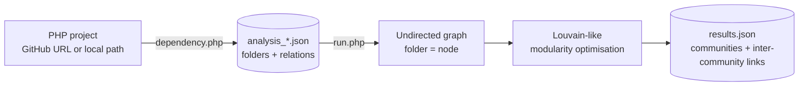
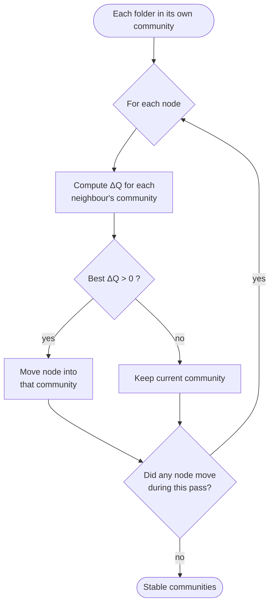
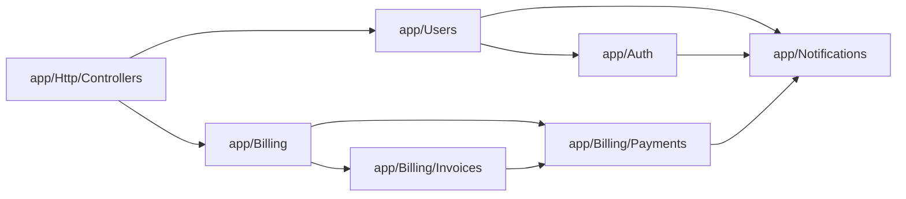
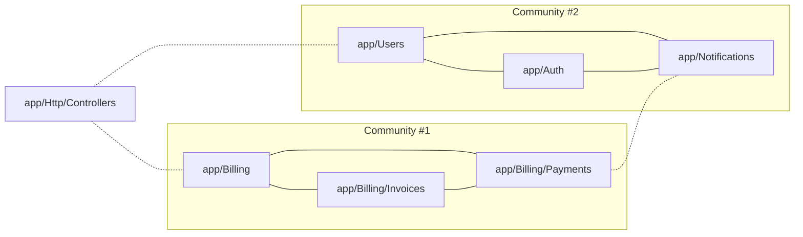
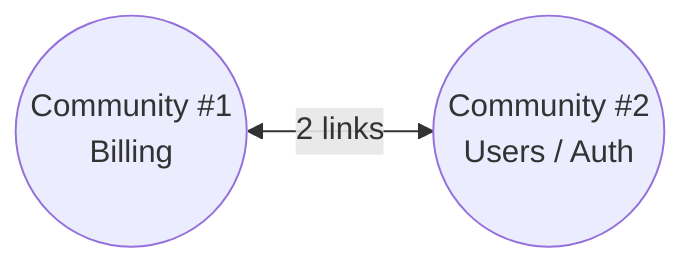

# algo-louvain-php

> 🇫🇷 **French readers:** the full write-up of this experiment is available on Laravel France: [Détecter des communautés dans un graphe de dépendances](https://laravel-france.com/posts/detecter-des-communautes-dans-un-graphe-de-dependances).

An experiment in **detecting communities in the dependency graph of a PHP project** with a simplified, pure-PHP version of the [Louvain algorithm](https://en.wikipedia.org/wiki/Louvain_method).

The question behind it: *if we only look at how folders depend on each other, can an algorithm find the "real" modules of a codebase?* Those modules may or may not match the folder structure chosen by the developers, and the gap between the two says a lot about the architecture.

## How it works

The experiment runs in two steps, each handled by one script.



### 1. Building the dependency graph: `dependency.php`

The script clones a GitHub repository (or reads a local folder) and walks through every directory that contains PHP files. Each **folder becomes a node**.

For every PHP file it:

- maps namespaces to folders (`namespace App\Billing;` → `app/Billing`);
- reads `use`, `extends` and `implements` statements and resolves them to target folders. Each one becomes a **relation** from the current folder to the target folder;
- computes a few metrics per folder: number of classes / interfaces / abstract classes, efferent and afferent coupling, instability (`Ce / (Ce + Ca)`), lines of code and an approximate cyclomatic complexity.

The result is saved to `analysis_<repo>_<date>.json`:

```json
{
    "app/Billing": {
        "classes": 4,
        "interfaces": 1,
        "relations": ["app/Models", "app/Support"],
        "metrics": { "efferent_coupling": 2, "afferent_coupling": 3, "instability": 0.4 }
    }
}
```

### 2. Detecting communities: `run.php`

The relations are turned into an **undirected graph**: if `A` depends on `B`, an edge links `A` and `B`. Direction doesn't matter here, we only care about which folders "live together".

Then the algorithm follows the first phase of Louvain:

1. every node starts alone in its own community;
2. for each node, compute the **modularity gain** of moving it into the community of each of its neighbours;
3. move it to the community with the best positive gain (or leave it where it is);
4. repeat over all nodes until no node moves anymore.



The gain is computed with the simplified Louvain formula:

$$
\Delta Q = \frac{k_{i,in}}{2m} - \frac{k_i \cdot \Sigma_{tot}}{4m^2}
$$

| Symbol | Meaning |
| --- | --- |
| $m$ | total number of edges in the graph |
| $k_i$ | degree of the node being moved |
| $k_{i,in}$ | number of edges between the node and the target community |
| $\Sigma_{tot}$ | sum of the degrees of the nodes in the target community |

Intuitively, the first term rewards joining a community the node is strongly connected to, while the second term penalises joining a community that is already large and highly connected (where links would exist "by chance" anyway).

Once communities are stable, the script counts the edges crossing community boundaries to build a **community graph**, and saves everything to `results.json`.

## Example

Take a small, illustrative Laravel-like application where each box is a folder and each arrow a `use` / `extends` / `implements` relation:



After a few passes, the algorithm groups the folders that are densely connected to each other:



`app/Http/Controllers` is a perfect bridge: one link to each community, so the gain is the same on both sides and the node keeps switching from one community to the other (see [Limitations](#limitations)). Dashed edges are the links crossing communities. They are summarised in the community graph:



Reading the output:

- **Communities matching a folder** (`app/Billing/*`) confirm that the structure reflects a real module.
- **Communities spanning unrelated folders** reveal modules the folder structure doesn't show, or a "hub" folder (here `app/Http/Controllers` or `app/Notifications`) that glues things together.
- **Many links between two communities** point to coupling worth investigating before extracting a module or a package.

## Usage

Requirements: PHP 8+ and `git` (only to analyse a remote repository).

```bash
# 1. Analyse a project (GitHub URL or local path, optional root folder)
php dependency.php https://github.com/laravel/framework src
php dependency.php /path/to/local/project app

# 2. Detect communities (uses the most recent analysis_*.json by default)
php run.php
php run.php analysis_framework_root_src_2025-01-01_12-00-00.json
```

`run.php` prints the communities, the dependencies between them and a simplified community graph, then writes `results.json`:

```text
Communautés détectées :

Communauté #1 (représentant: app/Billing/Invoices) :
  - app/Http/Controllers
  - app/Billing
  - app/Billing/Invoices
  - app/Billing/Payments

Communauté #2 (représentant: app/Notifications) :
  - app/Users
  - app/Auth
  - app/Notifications

═══════════════════════════════════════════════════════════════
Dépendances entre communautés :

Communauté #1 (app/Billing/Invoices) dépend de :
  → Communauté #2 (app/Notifications) : 2 lien(s)

Communauté #2 (app/Notifications) dépend de :
  → Communauté #1 (app/Billing/Invoices) : 2 lien(s)

═══════════════════════════════════════════════════════════════
Graphe des communautés (format simplifié) :

Communauté #1 → #2
Communauté #2 → #1
```

> The console output is in French, as the experiment was originally written for a French-speaking audience.

## Limitations

This is an experiment, not a production tool:

- **The loop may never stop**: the node is not removed from its own community before computing ΔQ, and community labels are the names of nodes that can move themselves. On small or symmetric graphs, nodes keep oscillating and `while ($changed)` never ends. Capping the number of passes (or removing the node from its community before evaluating moves) is needed to get a result.
- **Only the first phase of Louvain** is implemented: there is no aggregation of communities into super-nodes followed by a new pass, so the result is a single level of communities.
- **Unweighted graph**: two folders linked by one `use` or by fifty are treated the same way.
- **Order-dependent**: nodes are visited in a fixed order, so the result may change slightly with the order of the folders.
- **Regex-based parsing**: dependencies are extracted with regular expressions rather than an AST, so some relations (inline FQCN, static calls, docblocks…) are missed.
- **Naive complexity**: `deltaModularity` iterates over the whole graph for each candidate move, which is fine for a few hundred folders but won't scale to very large codebases.

## Further reading

- 🇫🇷 [Détecter des communautés dans un graphe de dépendances](https://laravel-france.com/posts/detecter-des-communautes-dans-un-graphe-de-dependances) (Laravel France)
- Blondel et al., [Fast unfolding of communities in large networks](https://arxiv.org/abs/0803.0476) (2008), the original Louvain paper
- [Modularity (networks)](https://en.wikipedia.org/wiki/Modularity_(networks)) on Wikipedia
